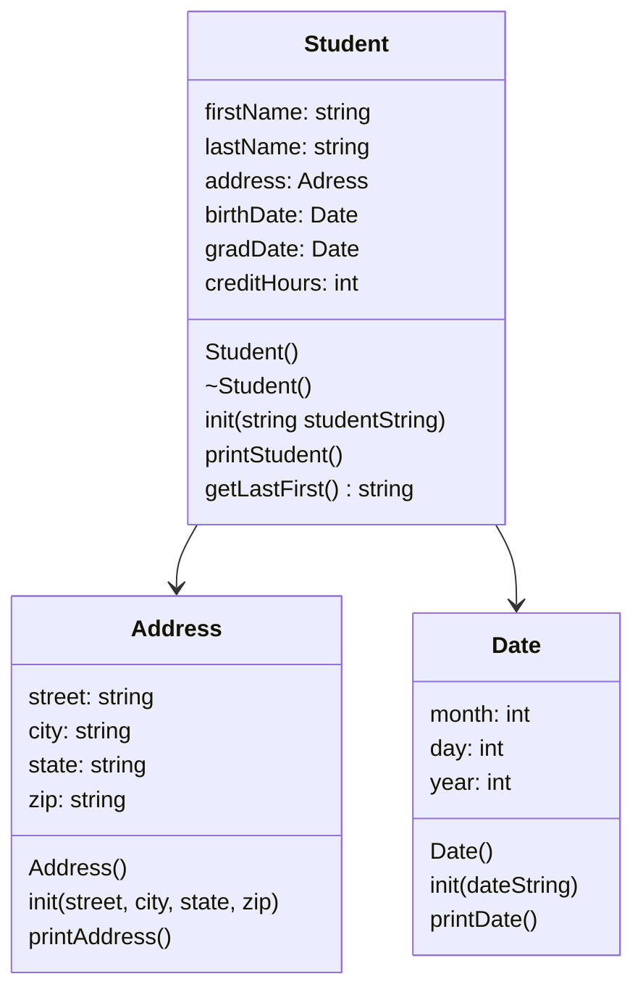

# heapofstudents2

# heapofstudents

# algorithms:

## data Parsing

- loaded string into std::stringstream
- used getline with / to extract month, day, year into strings
- converted strings to integers with std::stoi
- stored integers in class member variables

## student data extraction

- loaded studentString into std::stringstream
- getline with , to pull out the parts in order they appeared (name, address, dates, credits)
- passed address into Address::init()
- date strings into date::init()
- final credit hours to integer

## student constructor 
- initialize firstName and lastName as empty strings
- initialize creditHours to 0
- create Address, birthDate, and gradDate objects on heap

## student destrutor
- delete Address object
- delete birthDate object
- delete gradDate object

## loadStudents
- open students.csv
- display error if file cant be opened
- read each line
- crete student object on heap
- initialize student with current line
- add studnet pointer to vector
- close the file

## printStudents
- loop through each student pointer in vector
- print complete student record
- print separator "______"

## showStudentNames
- loop thru each student pnter in vector
- get students last name and first name
- print name in last name first name format

## findstudent
- ask user for lsat name
- loop thru each student pointer
- get students last name
- search for text within last name
- if match, print student record
- if no matches, display error
## delStudents
- loop thru each student pointer in vector
- delete each student obj
- clear vector
## menu
- display menu options
- ask user to enter choice
- read choice as string
- return choice
## main
- make vector of student pointers
- load student records from csv
- repeat until user quits
- display menu
- 1 = print all stdnt names
- 2 = print all stdnt records
- 3 = search for stdnts
- if user enters invalid choice, error
- delete all student objects
