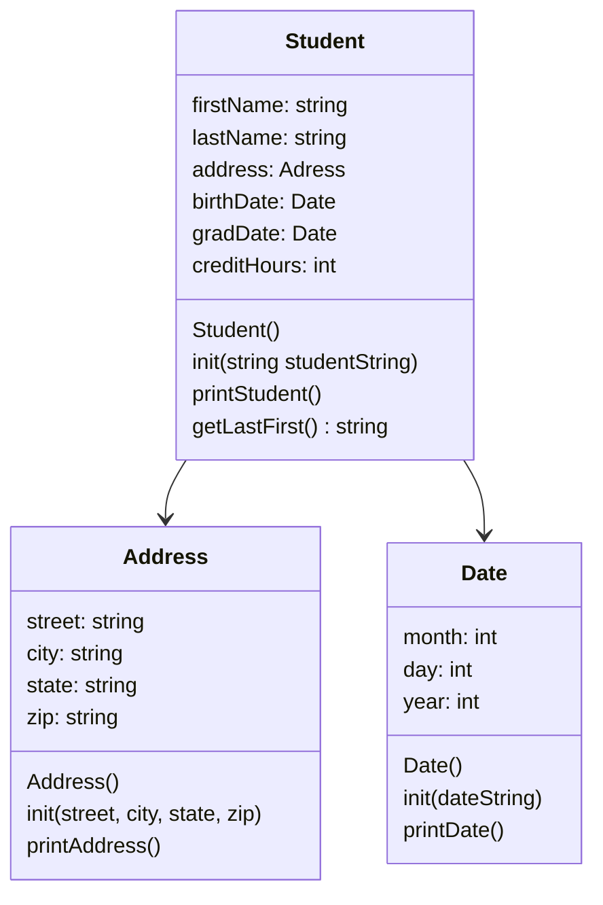

# heapofstudents2

# heapofstudents

# algorithms:

## data Parsing

- loaded string into std::stringstream
- used getline with / to extract month, day, year into strings
- converted strings to integers with std::stoi
- stored integers in class member variables

## student data extraction

- loaded studentString into std::stringstream
- getline with , to pull out the parts in order they appeared (name, address, dates, credits)
- passed address into Address::init()
- date strings into date::init()
- final credit hours to integer

